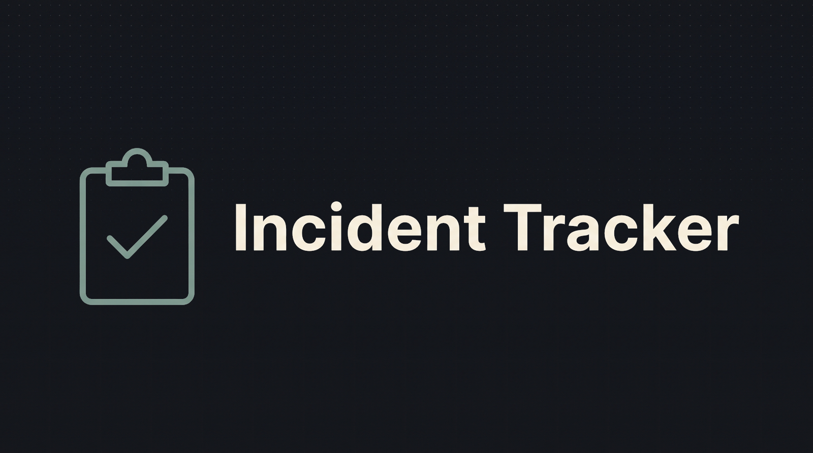

# incident-tracker


[](https://github.com/PresidenteOG/incident-tracker/actions/workflows/ci.yml)


A small internal tool for logging IT incidents and tracking their status. Log in, see every
incident with its priority and current status, add a new one, edit it, and mark it closed —
at which point the app records the close time and works out how long it was open. Statuses
(open, in progress, closed) are managed on their own screen and each incident points at one.

Server-rendered with Spring Boot and Thymeleaf, JPA over an in-memory H2 database. It runs
offline with nothing to configure — the database is created and filled with demo data every
time the app starts.

**Live:** https://incident-tracker-6sbn.onrender.com — log in with `admin` / `admin`.
It runs on Render's free tier, so the first request can take over a minute while the instance
wakes up. A scheduled ping usually keeps it awake, but GitHub sometimes runs that late.

## Start here

If you only read one file, read
[`IncidenciaServiceImpl`](./src/main/java/com/dam/incidencias/service/IncidenciaServiceImpl.java).
`saveIncidencia` is where the one real decision lives: a new incident gets its opening time
stamped and defaults to *open*; an edit keeps the original opening time no matter what the
form sent; moving an incident to *closed* stamps the close time and stores how long it was
open in minutes (shown as `2h 30m`), and moving it back off *closed* clears both. The matching test,
[`IncidenciaServiceImplTest`](./src/test/java/com/dam/incidencias/service/IncidenciaServiceImplTest.java),
pins each of those branches with the DAOs mocked. Everything else — controllers, the status
CRUD screen, the hardcoded login — is plain Spring MVC glue around that.

## Run it

```
git clone https://github.com/PresidenteOG/incident-tracker.git
cd incident-tracker
./mvnw spring-boot:run
```

Then open <http://localhost:8080> and log in:

| User | Password |
|---|---|
| `admin` | `admin` |

That is the only account — there is no user table, the check is against a hardcoded pair (see
`IncidenciaServiceImpl.checkLogin`). The incident list loads with a dozen invented incidents
spread across the three statuses and both open and closed, so every screen has data. The H2
console is at <http://localhost:8080/h2-console> (JDBC URL `jdbc:h2:mem:incidenciasdb`).

## Screenshots

From a local run on the seeded data.

 | 
:---:|:---:
Login (`admin` / `admin`) | Incident list, mixed statuses and priorities

 | 
:---:|:---:
Logging a new incident | Editing one — changing the status is what records the close time


:---:
The three statuses, managed on their own screen

## Tests

```
./mvnw verify
```

52 tests. The largest group is unit tests on the service layer with the DAOs mocked
(`IncidenciaServiceImplTest`, `EstadoServiceImplTest`), with no Spring context. Two
`@WebMvcTest` classes drive the controllers through MockMvc with the real interceptor and
Thymeleaf views, covering the list and edit screens, form binding, login and the 404 page. A
`@DataJpaTest` slice (`IncidenciaDAOTest`) runs the real JPA layer against H2 and checks the
seed, the `Incidencia → Estado` mapping and that the status ids used in code match
`data.sql`. A small test covers the resolution-time formatting, and a `@SpringBootTest` smoke
test boots the whole context. JaCoCo runs in the `verify` phase; the coverage badges above are
regenerated from its report by CI on every push to `master`.

## Scope and known limits

This is a demo, not a deployable service.

- The database is in-memory H2. It is rebuilt from `data.sql` on every start, so anything
  added through the UI is gone after a restart.
- Login is session-based against one hardcoded account (`admin` / `admin`). There is no user
  table, no password hashing and no roles.
- Delete actions are `GET` links and there is no CSRF protection.
- The only server-side validation is the HTML `required` attribute on the forms.
- Class names, URLs and the text in the views are still Spanish. The Java fields are English;
  the database columns keep their original names.

## Design decisions

- The service layer holds the one rule that matters (default status, opening time, closing
  time and duration). Controllers only map requests to it.
- Dependencies come in through constructors, so the services are built in tests with plain
  mocks and no Spring.
- *Open* and *closed* are found by id (`Estado.OPEN_ID`, `Estado.CLOSED_ID`), not by name,
  because the names can be edited on the status screen. `data.sql` seeds those ids and a DAO
  test fails if they drift.
- Resolution time is stored as minutes in a `Long`. `Incidencia.getResolutionTime()` turns it
  into `2h 30m` for display, so the format lives in one place.
- A lookup or delete on an id that does not exist throws `IncidenciaNotFoundException` or
  `EstadoNotFoundException`, and a `@ControllerAdvice` renders a 404 page. Services no longer
  return `null` for a missing row.

## Architecture

Browser → controller → service → Spring Data JPA repository → H2. MVC, not REST; no JSON API.
[ARCHITECTURE.md](./ARCHITECTURE.md) walks through it and covers what was reconstructed to get
the project building again.

## License

PolyForm Noncommercial 1.0.0 — see [LICENSE](./LICENSE). Free to read, run and fork for
personal and non-commercial use.
